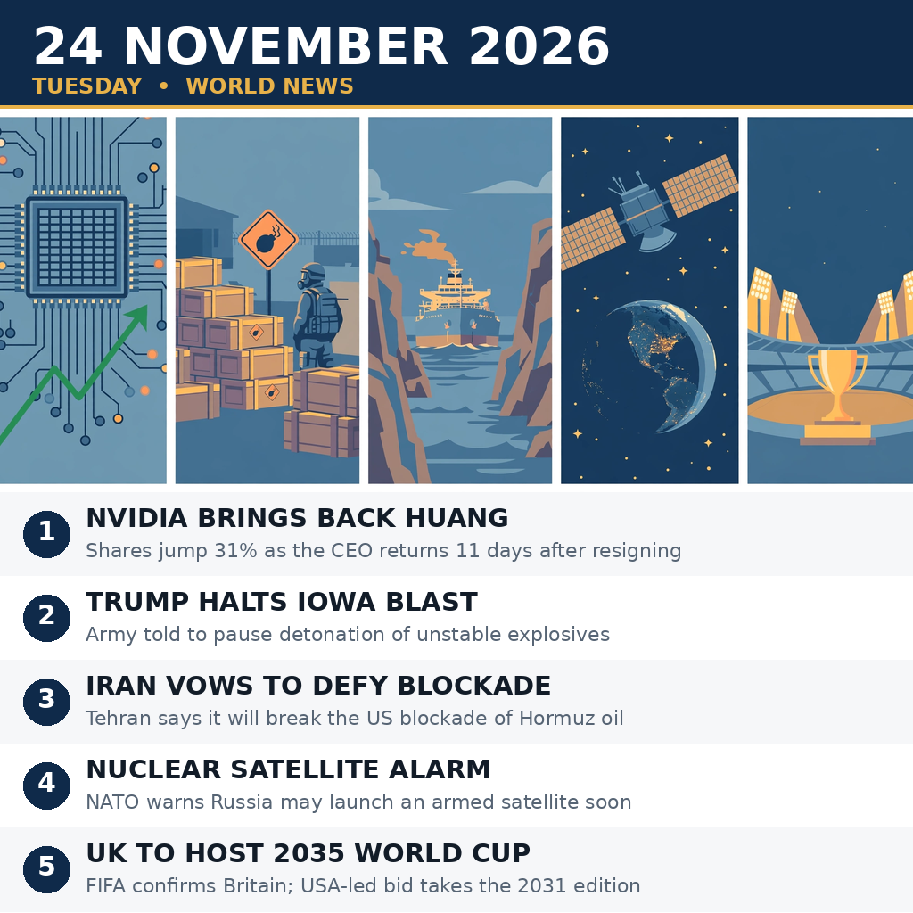

# World News in One Image — 24 November 2026

Entry for the [make.fun](https://make.fun) competition
**news-image-20261124**: sum up Tuesday 24 November 2026's world news
in a single image.



## What the image shows

The banner names the day — **24 November 2026** — above a five-panel
illustration, with five stories listed below it:

1. **NVIDIA brings back Huang** — Nvidia's board reinstated Jensen Huang
   as president and CEO, 11 days after he resigned; shares jumped about
   31%. (Nvidia newsroom, 23 Nov 2026; Reuters; The Hindu BusinessLine,
   24 Nov 2026)
2. **Trump halts Iowa blast** — President Trump ordered the US Army to
   pause its plan to detonate unstable lead-azide explosives at the Iowa
   Army Ammunition Plant. (CNN, 23 Nov 2026)
3. **Iran vows to defy blockade** — Iran said it would use every means to
   counter the US naval blockade of the Strait of Hormuz, after Trump
   warned Iranian ships testing it would be sunk. (Reuters, 23 Nov 2026)
4. **Nuclear satellite alarm** — Western intelligence, reported by German
   media, warned Russia may launch a nuclear-armed satellite ("Sputnik-S")
   within weeks; NATO said its defence pledge covers space. (Reuters /
   NDR–WDR–Süddeutsche Zeitung, 23 Nov 2026)
5. **UK to host 2035 World Cup** — FIFA confirmed England, Northern
   Ireland, Scotland and Wales as hosts of the 2035 Women's World Cup,
   and a US-led bid for the 2031 edition. (Reuters / FIFA, 23 Nov 2026)

Stories were selected from reporting published on 24 November 2026 in
Asian time zones (or on 23 November in the Americas, i.e. 24 November in
Asia/Australasia). The image was drawn for this entry and the text was
added with Python (PIL); no stock photos or other entries' artwork were
used.

## How it works

`main.ts` (Node 22, standard library only) copies the pre-rendered
`entry.png` to `$MAKEFUN_OUTPUT_DIR/entry.png`. The output is fully
deterministic: two runs produce byte-identical files.

## Verify locally

```sh
mkdir -p out1 out2
MAKEFUN_OUTPUT_DIR=out1 node main.ts
MAKEFUN_OUTPUT_DIR=out2 node main.ts
sha256sum out1/entry.png out2/entry.png entry.png
# all three hashes must match
```

The image is 1024×1024 px and under 1 MiB, within the competition limits.

## License

MIT — see [LICENSE](LICENSE).
